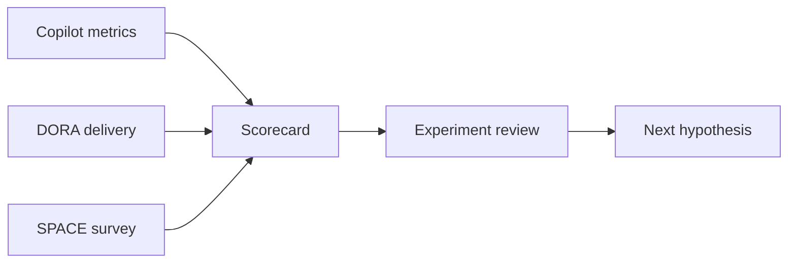

---
tags:
- github-copilot
- metrics
- dora
- space
- simulation
lab:
  id: 095
  level: L300
  journey: copilot
  time_min: 75
  cost:
    tier: free
    requires: []
    estimate_usd: 0 within the documented free path or simulation.
    simulation: true
    cleanup: false
  roles:
  - developer
  - student
  - architect
  technologies:
  - github-copilot
  - metrics
  - dora
  - space
  - simulation
  status: active
  last_verified: '2026-10-27'
  languages:
  - en
  - pt
  - fr
---
# Lab 095: Medindo o Impacto do Copilot: API de Métricas, DORA e SPACE

<div class="lab-meta">
  <span><strong>Nível:</strong> <span class="level-badge level-300">L300</span></span>
  <span><strong>Jornada:</strong> copilot</span>
  <span><strong>Tempo:</strong> ~75 min</span>
  <span><strong>Custo:</strong> <span class="level-badge cost-free">Grátis</span></span>
</div>

!!! info "Desenho gratuito primeiro"
    O caminho obrigatório é local, simulado ou funciona com GitHub Copilot Free. Todo caminho organizacional, de nuvem ou pago está marcado como opcional.

!!! tip "Impacto em AI Credits"
    Mantenha a tarefa limitada, use o menor contexto útil e valide localmente. Execuções repetidas de agentes e modelos premium podem consumir mais AI Credits.

## O que você aprenderá

- Distinguir adoção, engajamento, aceitação, entrega e experiência
- Evitar atribuir mudanças DORA a uma ferramenta sem controles
- Usar SPACE como framework equilibrado
- Criar scorecard com privacidade usando dados simulados

## Pré-requisitos

- Python 3.10+ para o exercício local
- Um editor de texto e terminal
- Lab 094

## Resultado e evidência

O lab só termina quando o aluno mostra evidência, não apenas descreve o conceito.

| Capacidade | Evidência obrigatória |
|---|---|
| Distinguir adoção, engajamento, aceitação, entrega e experiência | `evidence/step-1.txt` mais um check local aprovado |
| Evitar atribuir mudanças DORA a uma ferramenta sem controles | `evidence/step-2.txt` mais um check local aprovado |
| Usar SPACE como framework equilibrado | `evidence/step-3.txt` mais um check local aprovado |
| Criar scorecard com privacidade usando dados simulados | `evidence/step-4.txt` mais um check local aprovado |

## Plano do lab

| Fase | Minutos | Atividade |
|---|---:|---|
| Preparar | 10 | Ler o cenário, inspecionar fixtures e registrar premissas |
| Linha de base | 15 | Executar o comportamento atual e salvar o resultado |
| Implementar | 25 | Concluir os quatro passos em mudanças pequenas |
| Validar | 15 | Executar testes, inspecionar falhas e coletar evidências |
| Revisar | 10+ | Explicar trade-offs e comparar o caminho real opcional |

## Modelo visual



## Cenário

A OutdoorGear precisa de uma solução explicável, testável e segura para workshops. O exercício obrigatório usa fixtures locais determinísticas, permitindo reprodução sem conta de nuvem. Depois, um serviço real pode substituir somente a fronteira do adaptador.

## Exercício guiado

### Step 1

**Objetivo:** Fazer uma melhoria observável preservando o contrato declarado.

**Ação:** Execute `impact_analysis.py` no conjunto fictício.

**Evidência:** Salve comando, resultado, arquivo alterado e uma frase explicando por que o resultado é confiável.

**Revisão:** Revise entradas, premissas, falhas, fronteira de segurança e o menor contexto útil.

### Step 2

**Objetivo:** Fazer uma melhoria observável preservando o contrato declarado.

**Ação:** Calcule adoção e uso ativo definindo denominadores.

**Evidência:** Salve comando, resultado, arquivo alterado e uma frase explicando por que o resultado é confiável.

**Revisão:** Revise entradas, premissas, falhas, fronteira de segurança e o menor contexto útil.

### Step 3

**Objetivo:** Fazer uma melhoria observável preservando o contrato declarado.

**Ação:** Compare sinais de entrega pré/pós e declare confundidores.

**Evidência:** Salve comando, resultado, arquivo alterado e uma frase explicando por que o resultado é confiável.

**Revisão:** Revise entradas, premissas, falhas, fronteira de segurança e o menor contexto útil.

### Step 4

**Objetivo:** Fazer uma melhoria observável preservando o contrato declarado.

**Ação:** Desenhe experimento com feedback SPACE e coortes mínimas.

**Evidência:** Salve comando, resultado, arquivo alterado e uma frase explicando por que o resultado é confiável.

**Revisão:** Revise entradas, premissas, falhas, fronteira de segurança e o menor contexto útil.

### Execute localmente

```bash
cd docs/docs/pt/labs/lab-095
python -m unittest discover -v
```

Crie uma pasta `evidence/` fora do repositório para guardar saídas. Não faça commit de credenciais, código privado ou dados pessoais.

## Rubrica de revisão

| Categoria | Evidência de conclusão |
|---|---|
| Correção | Testes provam o comportamento e os limites importantes. |
| Evidência | Comandos, resultados e premissas são reproduzíveis. |
| Segurança | Entradas, permissões, segredos e efeitos colaterais estão controlados. |
| Manutenibilidade | A solução é limitada, legível e reversível. |

## Falhas comuns e recuperação

| Falha | Recuperação |
|---|---|
| O caminho feliz passa, mas os limites falham. | Adicione casos negativos, vazios, máximos e malformados. |
| O modelo propõe reescrita ampla. | Volte à menor mudança que preserva comportamento e repita a linha de base. |
| Ferramenta ou documento recuperado contém instruções. | Trate como dado não confiável e aplique política fora do modelo. |
| O resultado não é reproduzível. | Fixe fixtures, registre versões e remova credenciais ocultas ou serviços mutáveis. |

## Acessibilidade e uso responsável

- Não dependa apenas de cores em diagramas ou resultados.
- Mantenha comandos copiáveis e forneça equivalentes textuais para evidência visual.
- Não coloque segredos, dados pessoais ou código privado em prompts e fixtures.
- Exija revisão humana antes de ações irreversíveis, de alto impacto ou em produção.

## Kit de apoio

O kit para download contém o guia do lab, exercícios locais, uma folha de consulta e os diagramas citados. A CI publica artefatos PDF e ZIP determinísticos.

| Item | Finalidade |
|---|---|
| `README.md` | Início rápido e evidência esperada |
| Fixtures locais Python/JSON/CSV | Exercício prático reproduzível |
| `CHEATSHEET.md` | Conceitos, comandos e checklist de revisão |
| PDF gerado | Guia imprimível produzido na CI |
| ZIP gerado | Kit offline produzido na CI |

## Caminho real opcional

Substitua somente a fronteira do adaptador por um serviço hospedado aprovado. Preserve fixtures, critérios de aceitação, telemetria e testes de regressão para comparar caminhos local e real. Verifique preço, retenção, região e políticas da organização antes.

## Verificação de conhecimento

??? question "Taxa de aceitação prova produtividade?"

    ??? success "Resposta"
        Não. É um sinal comportamental que precisa de contexto de entrega e experiência.

??? question "Que evidência deve ser salva?"

    ??? success "Resposta"
        Comando, resultado, arquivo alterado, premissas e uma explicação curta de confiança.

??? question "Quando usar o caminho real opcional?"

    ??? success "Resposta"
        Depois que o contrato local passar e preço, política, dados e limpeza forem compreendidos.

## Critérios de saída

- [ ] O exercício local passa sem credenciais.
- [ ] Evidências e premissas estão registradas.
- [ ] Recursos pagos ou organizacionais continuam opcionais.
- [ ] Segurança, acessibilidade e falhas foram revisadas.
- [ ] O kit gerado pode ser reproduzido a partir do código-fonte.

## Fontes públicas

- [GitHub Copilot usage metrics REST API](https://docs.github.com/rest/copilot/copilot-usage-metrics)
- [DORA metrics](https://dora.dev/guides/dora-metrics-four-keys/)
- [SPACE framework](https://queue.acm.org/detail.cfm?id=3454124)
