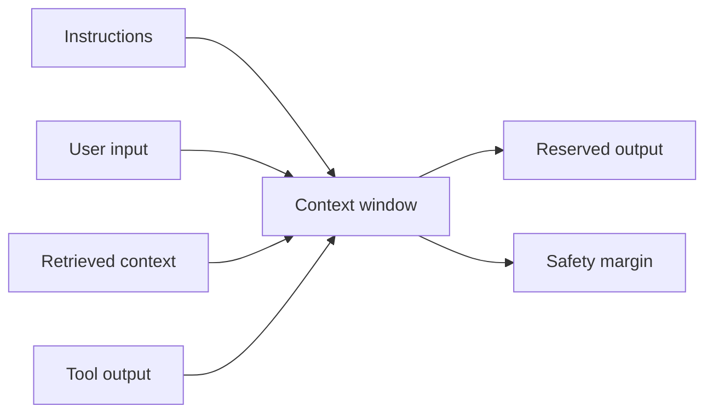

---
tags:
- tokens
- sampling
- context-window
- llm
lab:
  id: '097'
  level: L50
  journey: llm-foundations
  time_min: 30
  cost:
    tier: free
    requires: []
    estimate_usd: 0 within the documented free path or simulation.
    simulation: true
    cleanup: false
  roles:
  - student
  - developer
  - architect
  technologies:
  - tokens
  - sampling
  - context-window
  - llm
  status: active
  last_verified: '2026-10-27'
  languages:
  - en
  - pt
  - fr
---
# Lab 097: Interativo: Tokens, Amostragem e Janelas de Contexto

  <strong>Level:</strong> L50
  <strong>Jornada:</strong> llm-foundations
  <strong>Tempo:</strong> ~30 min
  <strong>Custo:</strong> Grátis

!!! info "Desenho gratuito primeiro"
    Conclua o exercício com Copilot Free ou com a simulação incluída. Recursos pagos são opcionais e marcados claramente.

!!! tip "Impacto em AI Credits"
    Baixo no exercício guiado; médio/alto em execuções agênticas ou repetidas. Prefira seleção automática de modelo, planeje antes de agir, mantenha o contexto focado e evite sessões paralelas desnecessárias.

## O que Você Aprenderá

- Estimar tokens a partir de texto
- Explicar temperatura, top-k e top-p
- Planejar uma janela de contexto
- Reconhecer truncamento e diluição de contexto

## Alinhamento GH-300

**Prompt and context foundations**. Este mapeamento segue o recorte curricular GH-300 de **07/08/2026**. O escopo oficial pode manter termos antigos como “Copilot Edits”; este lab ensina a experiência atual e sinaliza a diferença.

## Mapa Conceitual

## Exercício Prático

### Etapa 1: Estime tokens

Use o widget abaixo. A estimativa usa aproximação transparente, não um tokenizer específico. Compare prosa, código, JSON e texto acentuado.

### Etapa 2: Explore amostragem

Mova temperatura, top-k e top-p. Preveja se a saída fica mais determinística ou diversa e revele a explicação.

### Etapa 3: Planeje a janela

Aloque instruções, entrada, contexto recuperado, saída de ferramentas e resposta. Preserve margem de segurança e remova contexto de baixo valor.

## Kit de apoio

O build do site gera downloads estáveis em PDF e ZIP. O ZIP contém o guia do lab e todos os arquivos de apoio declarados para este lab.

- [Baixar PDF gerado](../downloads/kits/lab-097-kit-pt.pdf)
- [Baixar ZIP gerado](../downloads/kits/lab-097-kit-pt.zip)
