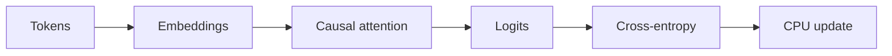

---
tags:
- gpt
- kit
- local-first
- phase-3
- quiz
lab:
  id: '103'
  level: L400
  journey: llm-foundations
  time_min: 180
  cost:
    tier: free
    requires: []
    estimate_usd: 0 for the local simulation; optional Real usage varies by service
      and must be capped.
    simulation: true
    cleanup: false
  roles:
  - developer
  - architect
  - student
  technologies:
  - gpt
  - phase-3
  status: active
  last_verified: '2026-10-27'
  languages:
  - en
  - pt
  - fr
---
# Lab 103: Mergulho Profundo: Treine um Mini-GPT na CPU (Opcional)

<div class="lab-meta">
  <span><strong>Level:</strong> <span class="level-badge level-400">L400</span></span>
  <span><strong>Jornada:</strong> llm-foundations</span>
  <span><strong>Tempo:</strong> ~180 min</span>
  <span><strong>Custo:</strong> free</span>
</div>

!!! info "Phase 3 · local first"
    O caminho obrigatório é determinístico e local. O caminho Real é opcional e inclui estimativa e limpeza.

## O que você aprenderá

- Implementar tokenização, embeddings, atenção e loss
- Treinar modelo minúsculo na CPU com seeds fixas
- Inspecionar overfitting e amostragem
- Explicar por que é exercício educacional

## Pré-requisitos

- Python 3.10+ e um terminal
- Nenhuma credencial para o caminho obrigatório
- Leia a especificação oficial vinculada antes de usar um adaptador hospedado

## Modelo visual



## Cenário

A OutdoorGear precisa de uma implementação revisável para workshop, com fixtures determinísticas, fronteiras de confiança explícitas, critérios mensuráveis e adaptador hospedado opcional e reversível.

## Exercício guiado

### Step 1: `tokenize`

1. Execute a fixture determinística desta etapa.
2. Registre entrada, saída, decisão de política e comportamento de falha.
3. Altere um comportamento limitado e execute o teste local novamente.

**Evidence:** Salve comando, resultado e uma frase explicando por que a evidência é confiável.

### Step 2: `train`

1. Execute a fixture determinística desta etapa.
2. Registre entrada, saída, decisão de política e comportamento de falha.
3. Altere um comportamento limitado e execute o teste local novamente.

**Evidence:** Salve comando, resultado e uma frase explicando por que a evidência é confiável.

### Step 3: `sample`

1. Execute a fixture determinística desta etapa.
2. Registre entrada, saída, decisão de política e comportamento de falha.
3. Altere um comportamento limitado e execute o teste local novamente.

**Evidence:** Salve comando, resultado e uma frase explicando por que a evidência é confiável.

### Step 4: `analyze_limits`

1. Execute a fixture determinística desta etapa.
2. Registre entrada, saída, decisão de política e comportamento de falha.
3. Altere um comportamento limitado e execute o teste local novamente.

**Evidence:** Salve comando, resultado e uma frase explicando por que a evidência é confiável.

### Execute localmente

```bash
cd docs/docs/pt/labs/lab-103
python -m unittest discover -v
```

## Simulação / Caminho Real

<div class="phase3-path-tabs" data-phase3-tabs>
  <div role="tablist" aria-label="Simulação / Caminho Real">
    <button type="button" role="tab" aria-selected="true" data-phase3-tab="simulation">Simulação</button>
    <button type="button" role="tab" aria-selected="false" data-phase3-tab="real">Caminho Real</button>
  </div>
  <section role="tabpanel" data-phase3-panel="simulation">
    Use as fixtures determinísticas e o validador local incluídos. Custo estimado: **US$0**.
  </section>
  <section role="tabpanel" data-phase3-panel="real" hidden>
    Substitua somente a fronteira do adaptador. Defina teto de gastos, preserve os testes e registre região, retenção, identidade, telemetria e preço. Exclua implantações, endpoints, índices, traces e dados de teste após a validação.
  </section>
</div>

## Kit de apoio

O build do site gera downloads estáveis em PDF e ZIP. A CI também mantém um espelho temporário por 30 dias.

- [`README.md`](lab-103/README.md): início rápido e checklist de evidências
- [`CHEATSHEET.md`](lab-103/CHEATSHEET.md): guia de decisão e revisão
- [`scenario.json`](lab-103/scenario.json): contrato determinístico
- [`test_scenario.py`](lab-103/test_scenario.py): testes locais
- [Baixar PDF gerado](../downloads/kits/lab-103-kit-pt.pdf)
- [Baixar ZIP gerado](../downloads/kits/lab-103-kit-pt.zip)

## Quiz pontuado

??? question "Por que manter um contrato local?"

    ??? success "Resposta"
        Ele cria uma linha de base determinística antes de adicionar variabilidade e custo hospedados.

??? question "Quando o caminho Real termina?"

    ??? success "Resposta"
        Somente após registrar evidência de validação e limpeza.

??? question "Como tratar a saída de ferramentas?"

    ??? success "Resposta"
        Como dado não confiável até a validação de política e esquema.

## Critérios de saída

- [ ] Testes locais passam sem credenciais.
- [ ] O diagrama tem explicação textual e não depende de cor.
- [ ] O quiz pontuado foi revisado.
- [ ] O caminho Real tem teto de custo e plano de limpeza.
- [ ] Fontes e estabilidade foram verificadas.

## Fontes públicas oficiais

- [PyTorch language modeling tutorial](https://pytorch.org/tutorials/beginner/transformer_tutorial.html)
- [Attention Is All You Need](https://arxiv.org/abs/1706.03762)
