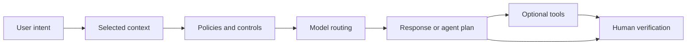

---
tags:
- github-copilot
- ai-credits
- models
- agents
lab:
  id: '107'
  level: L50
  journey: copilot
  time_min: 25
  cost:
    tier: free
    requires: []
    estimate_usd: 0 within the documented free path or simulation.
    simulation: true
    cleanup: false
  roles:
  - student
  - developer
  - admin
  - architect
  technologies:
  - github-copilot
  - ai-credits
  - models
  - agents
  status: active
  last_verified: '2026-10-27'
  languages:
  - en
  - pt
  - fr
---
# Lab 107: Como o GitHub Copilot Funciona: Contexto, Modelos, Agentes e Fluxo de Dados

  <strong>Level:</strong> L50
  <strong>Jornada:</strong> copilot
  <strong>Tempo:</strong> ~25 min
  <strong>Custo:</strong> Grátis

!!! info "Desenho gratuito primeiro"
    Conclua o exercício com Copilot Free ou com a simulação incluída. Recursos pagos são opcionais e marcados claramente.

!!! tip "Impacto em AI Credits"
    Baixo no exercício guiado; médio/alto em execuções agênticas ou repetidas. Prefira seleção automática de modelo, planeje antes de agir, mantenha o contexto focado e evite sessões paralelas desnecessárias.

## O que Você Aprenderá

- Descrever o ciclo de uma solicitação ao Copilot
- Separar seleção de contexto de seleção de modelo
- Distinguir completions, chat e agentes
- Explicar limites de dados, retenção e AI Credits conceitualmente

## Alinhamento GH-300

**GH-300 foundation · Data and architecture**. Este mapeamento segue o recorte curricular GH-300 de **07/08/2026**. O escopo oficial pode manter termos antigos como “Copilot Edits”; este lab ensina a experiência atual e sinaliza a diferença.

## Mapa Conceitual

## Exercício Prático

### Etapa 1: Rastreie uma solicitação

Siga sinais do editor, referências explícitas, instruções, políticas, roteamento de modelo, geração e verificação humana.

### Etapa 2: Compare experiências

Completions predizem código no fluxo de edição; chat responde conversas; agentes planejam e usam ferramentas em várias etapas.

### Etapa 3: Mapeie dados e cobrança

Documente quem controla o repositório, qual contexto sai do cliente, retenção e exclusão aplicáveis e quais interações consomem AI Credits.

