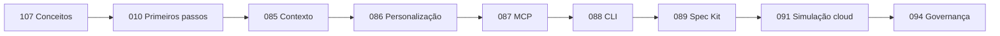

# 🤖 Trilha GitHub Copilot

L100 L200 L300 L400

Aprenda o fluxo atual do Copilot: completações, Ask, Plan, Agent, chat inline, MCP, aprovações seguras e instruções do repositório.

## Labs Atuais

| Lab | Título | Nível | Custo |
|-----|--------|-------|-------|
| [Lab 010](../../labs/lab-010-github-copilot-first-steps.md) | GitHub Copilot — Primeiros Passos | L100 | GRÁTIS·GH |
| [Lab 016](../../labs/lab-016-copilot-agent-mode.md) | Copilot Agent e Plan | L100 | GRÁTIS·GH |
| [Lab 025](../../labs/lab-025-vscode-chat-participant.md) | VS Code Chat Participant | L200 | GRÁTIS·GH |
| [Lab 081](../../labs/lab-081-agentic-coding-tools.md) | Ferramentas de Programação Agêntica | L100 | GRÁTIS |
| [Lab 085](../../labs/lab-085-copilot-prompt-context-engineering.md) | Engenharia de Prompt e Contexto | L100 | GRÁTIS · GH |
| [Lab 086](../../labs/lab-086-customize-copilot.md) | Instruções, Prompt Files, Agentes e Skills | L200 | GRÁTIS · GH |
| [Lab 087](../../labs/lab-087-copilot-mcp.md) | Copilot + MCP | L200 | GRÁTIS · GH |
| [Lab 088](../../labs/lab-088-copilot-cli.md) | Copilot CLI | L200 | GRÁTIS · GH |
| [Lab 089](../../labs/lab-089-spec-kit.md) | Desenvolvimento Orientado a Especificação | L200 | GRÁTIS · GH |
| [Lab 091](../../labs/lab-091-cloud-agent-code-review.md) | Cloud Agent e Code Review | L300 | Simulação GRÁTIS / caminho real PAGO |
| [Lab 094](../../labs/lab-094-copilot-governance-finops.md) | Governança e FinOps | L300 | Simulação GRÁTIS |
| [Lab 107](../../labs/lab-107-how-copilot-works.md) | Como o GitHub Copilot Funciona | L50 | GRÁTIS |

## Status da Migração 2026

- O Lab 041 foi aposentado porque as Copilot Extensions baseadas em GitHub Apps foram descontinuadas. Use MCP, a API do VS Code ou o futuro lab do Copilot SDK.
- O Lab 045 foi aposentado porque o Copilot Workspace foi descontinuado. Use Plan e Agent; o roadmap adiciona um lab de Spec Kit.
- Os Labs 085–094 agora cobrem instruções, skills, MCP, CLI, Spec Kit, cloud agent, code review, governança e FinOps.

## Sequência Recomendada para 2026

→ [Siga a trilha GH-300 de quatro semanas](../gh-300/index.md)

## Copilot Free

Esta trilha foi desenhada para funcionar no Copilot Free, salvo quando um lab estiver explicitamente marcado como pago ou simulado. O plano inclui uma cota de completações e uma franquia limitada de AI Credits; a disponibilidade exata pode mudar, por isso os labs não fixam cotas de chat ou modelos.

→ [Ativar o GitHub Copilot Free](https://github.com/features/copilot)

## Recursos Externos

- [Documentação do GitHub Copilot](https://docs.github.com/copilot)
- [Personalizar o Copilot](https://docs.github.com/copilot/customizing-copilot)
- [Model Context Protocol](https://modelcontextprotocol.io/)
