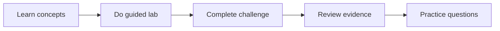

# Trilha de Certificação GH-300 GitHub Copilot

Coorte equilibrada de quatro semanas para estudantes e workshops enterprise. Toda semana inclui caminho grátis; atividades exclusivas de organização são simulações, salvo indicação opcional e paga.

!!! warning "2026 terminology"
    O escopo oficial datado de 07/08/2026 ainda pode citar “Copilot Edits”. Aprenda Ask, Plan e Agent atuais, mas reconheça o termo legado na prova.

## Coorte de Quatro Semanas

| Semana | Trabalho obrigatório | Ênfase GH-300 |
|---|---|---|
| Semana 1 — Fundamentos e IA responsável | Labs 107, 010, 085 e 008 | IA responsável (15–20%); prompt e contexto (10–15%) |
| Semana 2 — Recursos do Copilot | Labs 016, 086, 087 e 088 | Usar recursos do Copilot (25–30%) |
| Semana 3 — Produtividade, testes e salvaguardas | Labs 089, 090 e 092 | Produtividade e testes (10–15%); privacidade e salvaguardas (10–15%) |
| Semana 4 — Governança e entrega | Labs 094, 091 (simulação) e simulado de 50 questões | Dados e arquitetura (10–15%) |

## Ritmo da Coorte

Cada workshop usa 90 minutos: 15 de conceitos, 45 de prática guiada, 15 de revisão em pares e 15 de reflexão no estilo da prova. Estudantes individuais podem dividir o trabalho em sessões menores.

## Rotas Gratuita e Enterprise

| Público | Rota |
|---|---|
| Comunidade / estudante | Copilot Free, ferramentas locais, simulações e repositórios públicos |
| Workshop enterprise | A mesma base grátis mais políticas opcionais, AI Controls, cloud agent e evidências de uso |

## Prática e Preparação para a Prova

Use a página oficial no Microsoft Learn, o sandbox e o simulado no Skills Navigator. Bancos comunitários são material secundário, nunca blueprint oficial.

- Explique por que uma resposta está correta, não apenas qual opção.
- Pratique privacidade, exclusão de conteúdo, aprovações e IA responsável.
- Acompanhe domínios fracos e repita os labs antes da simulação final.

## Simulado de 50 Questões

O simulador cobre o currículo por cinco personas. Somente a pontuação final é salva neste navegador.

## Recursos Oficiais

- [GH-300 certification](https://learn.microsoft.com/credentials/certifications/github-copilot/)
- [GitHub Copilot documentation](https://docs.github.com/copilot)
- [Copilot plans](https://docs.github.com/copilot/get-started/plans)
## Desafios da Fase 2

- [Challenge 010](../../challenges/challenge-010-spec-to-pr.md) valida o fluxo da spec ao PR com testes locais.
