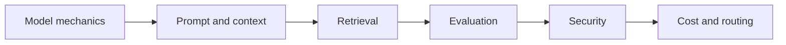

# Trilha Fundamentos de LLM 2.0

Construa uma base atual e local para comportamento, recuperação, avaliação, segurança, contexto e custo.

| Lab | Title | Level | Time |
|---|---|---|---|
| [Lab 004](../../labs/lab-004-how-llms-work.md) | Como LLMs Funcionam: Tokens, Atenção, Treino e Alucinação | L50 | 45 min |
| [Lab 005](../../labs/lab-005-prompt-engineering.md) | Prompting e Engenharia de Contexto | L50 | 60 min |
| [Lab 007](../../labs/lab-007-what-are-embeddings.md) | Embeddings e Busca de Similaridade Local | L50 | 60 min |
| [Lab 017](../../labs/lab-017-structured-output.md) | Saída Estruturada Confiável com Validação Local | L100 | 60 min |
| [Lab 018](../../labs/lab-018-function-calling.md) | Chamadas de Ferramentas com Contratos Locais Tipados | L100 | 60 min |
| [Lab 019](../../labs/lab-019-streaming-responses.md) | Respostas em Streaming: Eventos, Cancelamento e UX Segura | L100 | 50 min |
| [Lab 022](../../labs/lab-022-rag-github-models-pgvector.md) | RAG Local: Chunking → Embedding → Busca → Resposta | L200 | 90 min |
| [Lab 097](../../labs/lab-097-tokens-sampling-context.md) | Interativo: Tokens, Amostragem e Janelas de Contexto | L50 | 30 min |
| [Lab 098](../../labs/lab-098-context-engineering-agents.md) | Engenharia de Contexto para Agentes | L200 | 75 min |
| [Lab 099](../../labs/lab-099-llm-evaluations.md) | Avaliações de LLM 101: Golden Sets, LLM-como-Juiz e Regressão em CI | L200 | 90 min |
| [Lab 100](../../labs/lab-100-owasp-llm-agentic-threat-modeling.md) | OWASP Top 10 para LLM e Apps Agênticos: Modelagem de Ameaças | L200 | 75 min |
| [Lab 101](../../labs/lab-101-token-economics.md) | Economia de Tokens: Custo, Cache, Lote e Roteamento | L200 | 60 min |

## Free-first route

All required exercises run locally with deterministic fixtures. Hosted embedding, generation, evaluation, and observability services are optional adapters.
